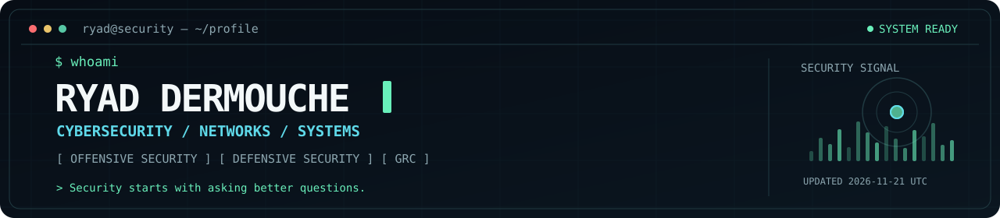

  <picture>
    <source media="(prefers-color-scheme: dark)" srcset="./assets/banner-dark.svg" />
    <source media="(prefers-color-scheme: light)" srcset="./assets/banner-light.svg" />
    
  </picture>

  

<h1 align="center">Hi 👋, I'm Mohammed Ryad Dermouche</h1>

<h3 align="center">
Cybersecurity Enthusiast | Networks, Systems & Security | SOC • Offensive • Defensive Security
</h3>

  Passionate about cybersecurity, system security, network defense, and hands-on technical learning.

  

  

 
   
  

---

## 🧠 About Me

- 🔐 Passionate about **Cybersecurity, Networks, and Systems**
- 🛡️ Interested in **SOC operations**, **incident detection**, **threat monitoring**, and **security analysis**
- ⚔️ Continuously improving my skills in **offensive and defensive security**
- 🌐 Strong interest in **network security**, **web security**, and **system hardening**
- 🧪 Learning through **labs, projects, CTFs, hackathons, and self-training**
- 📚 Focused on building strong technical and practical cybersecurity skills
- 💬 Ask me about **cybersecurity, network security, web security, SOC, and security standards**
- 📫 Reach me at: **dermoucheryad@gmail.com**
- ⚡ Fun fact: **Black belt karateka 🥋**

---

## 🎯 Focus Areas

  
  
  
  
  
  

---

## 🚀 Featured Projects

- 🔐 **NIS Cube** — Security gap analysis, NIS2-oriented assessment, and risk-focused cybersecurity project
- 🧪 **Security Labs** — Practical labs in systems, networks, and offensive/defensive security
- 🌐 **Network Analysis Projects** — Network observation, traffic understanding, and protocol-focused exercises
- 💻 **Web / Dev Projects** — Development projects showcasing programming and problem-solving skills

👉 Explore more here:  
**https://dermoucheryad.github.io/My_Portfolio_web_site/**

---

## 🛠️ Languages & Tools

  
  
  
  
  
  
  
  
  
  
  
  
  
  
  
  
  

---

## 📈 GitHub Stats

  

&nbsp;
  

  

---

## 🤝 Connect with Me

---

## 🐍 Contribution Graph

<picture>
  <source media="(prefers-color-scheme: dark)" srcset="https://raw.githubusercontent.com/DERMOUCHERYAD/DERMOUCHERYAD/output/github-snake-dark.svg" />
  <source media="(prefers-color-scheme: light)" srcset="https://raw.githubusercontent.com/DERMOUCHERYAD/DERMOUCHERYAD/output/github-snake.svg" />
  
</picture>
