<div align="center">

  <!-- CINEMATIC SVG HERO -->
  <picture>
    <source media="(prefers-color-scheme: dark)" srcset="./assets/banner-svg.svg" />
    <source media="(prefers-color-scheme: light)" srcset="./assets/banner-svg.svg" />
    
  </picture>

  <!-- TERMINAL-STYLE WELCOME -->
  <a href="https://github.com/DERMOUCHERYAD">
    
  </a>

  <p>
    <code>SECURE SESSION ESTABLISHED</code> &nbsp;•&nbsp;
    <code>CYBERSECURITY ENGINEERING</code> &nbsp;•&nbsp;
    <code>BUILD / BREAK / SECURE</code>
  </p>

  <p>
    <a href="https://linkedin.com/in/mohammed-ryad-dermouche"></a>
    <a href="mailto:dermoucheryad@gmail.com"></a>
    <a href="https://dermoucheryad.github.io/My_Portfolio_web_site/"></a>
  </p>

  

</div>

---

## `01 // whoami`

```bash
$ whoami
ryad@cybersec

$ cat profile.txt
Name     : Ryad Dermouche
Focus    : Cybersecurity | Networks | Systems
Domains  : Offensive Security | Defensive Security | GRC
Approach : Learn. Build. Break. Secure.
```

I'm passionate about **Cybersecurity, Network & System Security**, with a strong interest in understanding how systems work, how they can be compromised, and how to protect them.

I explore cybersecurity through **hands-on labs, security research, CTF challenges, and practical projects**, combining offensive techniques with defensive strategies and risk-oriented approaches.

> **Understanding the attack. Strengthening the defense.**

---

## `02 // security_focus`

<table>
  <tr>
    <td width="50%" valign="top">
      <h3>⚔️ Offensive Security</h3>
      <ul>
        <li>Penetration Testing Fundamentals</li>
        <li>Web Application Security</li>
        <li>Vulnerability Assessment</li>
        <li>Network Reconnaissance &amp; Enumeration</li>
        <li>Exploitation Labs &amp; CTF Challenges</li>
        <li>OWASP Top 10</li>
      </ul>
    </td>
    <td width="50%" valign="top">
      <h3>🛡️ Defensive Security</h3>
      <ul>
        <li>Security Operations (SOC)</li>
        <li>Threat Detection &amp; Monitoring</li>
        <li>Incident Detection &amp; Response</li>
        <li>Network Traffic Analysis</li>
        <li>System Hardening</li>
        <li>Security Logging &amp; SIEM</li>
      </ul>
    </td>
  </tr>
  <tr>
    <td width="50%" valign="top">
      <h3>🌐 Networks &amp; Systems</h3>
      <ul>
        <li>TCP/IP, DNS, DHCP, VLANs</li>
        <li>Linux &amp; Windows Administration</li>
        <li>Network Services &amp; Security</li>
        <li>Virtualization &amp; Containers</li>
        <li>Active Directory Fundamentals</li>
        <li>Infrastructure Security</li>
      </ul>
    </td>
    <td width="50%" valign="top">
      <h3>🔐 Governance, Risk &amp; Compliance</h3>
      <ul>
        <li>Cybersecurity Risk Assessment</li>
        <li>Security Gap Analysis</li>
        <li>Security Controls &amp; Compliance</li>
        <li>ISO 27001 / 27002 / 27005</li>
        <li>NIST Cybersecurity Framework</li>
        <li>NIS2 &amp; GDPR</li>
      </ul>
    </td>
  </tr>
</table>

---

## `03 // featured_projects`

A selection of practical projects exploring **cybersecurity, networking, systems, and secure development**.

### 🔐 NIS Cube — Cybersecurity Risk & Compliance

A cybersecurity-oriented project focusing on organizational security assessment and regulatory requirements.

- NIS2-oriented security assessment
- Security gap identification
- Cybersecurity risk analysis
- Security controls and recommendations

### 🧪 Cybersecurity Labs

Hands-on environments exploring offensive and defensive security concepts.

- Web security and vulnerability testing
- Linux security and privilege escalation
- Network reconnaissance and enumeration
- Security tools and exploitation techniques

### 🌐 Network & Infrastructure Projects

Practical projects focused on understanding, deploying, and securing networked systems.

- Network protocols and traffic analysis
- Network configuration and troubleshooting
- Virtualized infrastructure
- Linux and Windows environments

<div align="center">

  <a href="https://github.com/DERMOUCHERYAD?tab=repositories">
    
  </a>

</div>

---

## `04 // technical_toolbox`

### 💻 Programming & Scripting

<p>
  
</p>

### 🖥️ Systems, Infrastructure & Development

<p>
  
</p>

### 🌐 Web & Databases

<p>
  
</p>

### 🔎 Cybersecurity Toolkit

<p>
  
  
  
  
  
  
  
</p>

---

## `05 // cybersecurity_journey`

```text
[+] Network & System Fundamentals
[+] Cybersecurity Principles
[+] Web & Network Security Labs
[+] Risk Assessment & Security Standards
[+] Capture The Flag Challenges
[+] Offensive & Defensive Security Practice
[~] Continuous Learning & Security Research
```

### 🏴‍☠️ Hands-on Learning & CTFs

I continuously develop my practical skills through cybersecurity challenges, labs, and security-focused communities.

**Platforms & activities:**

- TryHackMe
- Hack The Box
- Root-Me
- Capture The Flag competitions
- Security labs and research projects

---

## `06 // github_telemetry`

<div align="center">

  

  

  <br/>

  

</div>

---

## `07 // contribution_activity`

<div align="center">

  <picture>
    <source media="(prefers-color-scheme: dark)" srcset="https://raw.githubusercontent.com/DERMOUCHERYAD/DERMOUCHERYAD/output/github-snake-dark.svg" />
    <source media="(prefers-color-scheme: light)" srcset="https://raw.githubusercontent.com/DERMOUCHERYAD/DERMOUCHERYAD/output/github-snake.svg" />
    
  </picture>

</div>

---

## `08 // connect`

<div align="center">

  <a href="https://linkedin.com/in/mohammed-ryad-dermouche">
    
  </a>
  <a href="mailto:dermoucheryad@gmail.com">
    
  </a>
  <a href="https://dermoucheryad.github.io/My_Portfolio_web_site/">
    
  </a>

  <br/><br/>

  <code>Security is a process, not a destination.</code>

  <br/><br/>

  

</div>
