<!--
  MOHAMMED RYAD DERMOUCHE · GitHub Profile
  Theme: Dark terminal / cyberpunk minimal
  Edit this README in github.com/DERMOUCHERYAD/DERMOUCHERYAD
-->

<div align="center">



[](https://github.com/DenverCoder1/readme-typing-svg)


**[LinkedIn](https://www.linkedin.com/in/mohammed-ryad-dermouche-0ba079228/)** · **[Portfolio](https://dermoucheryad.github.io/My_Portfolio_web_site/)** · **[Email](mailto:dermoucheryad@gmail.com)**

</div>

---

## `01` / WHOAMI

> I explore how systems break, how attacks are detected, and how security can be engineered into systems and organizations.

I'm **Mohammed Ryad Dermouche**, a cybersecurity master's student at **Sorbonne Université (MSI)** and a **Cybersecurity GRC Apprentice at Valeo**, based in Paris.

My interests span three complementary areas: **offensive security**, **defensive security**, and **governance, risk & compliance (GRC)**. I learn through hands-on labs, security projects, CTFs, and technical research — bridging the gap between attack techniques, defensive controls, and business risk.

```text
ryad@security:~$ cat /etc/profile

  IDENTITY     Mohammed Ryad Dermouche
  EDUCATION    Master's in MSI · Sorbonne Université
  EXPERIENCE   Cybersecurity GRC Apprentice · Valeo
  LOCATION     Paris, France
  PRINCIPLE    Understand the attack. Strengthen the defense.

ryad@security:~$ _
```

## `02` / SECURITY DOMAINS

| `RED TEAM` / Offensive | `BLUE TEAM` / Defensive | `GRC` / Security Governance |
| :--- | :--- | :--- |
| Web security & vulnerability research | Network traffic analysis | Cyber risk assessments |
| Reconnaissance & enumeration | Detection and incident analysis | ISO 27001 / 27005 & NIST CSF |
| Linux / Windows security labs | System & network hardening | NIS2, security controls & compliance |
| CTFs, HTB & TryHackMe | SOC fundamentals | Risk-based security decisions |

<details>
<summary><b>▸ EXPAND: Tools, platforms and technologies</b></summary>
<br/>

**Languages & scripting:** Python · Bash · PowerShell · C/C++ · Java · SQL  
**Systems & infrastructure:** Linux · Windows Server · Active Directory · Docker · Proxmox · VirtualBox  
**Network & security tooling:** Wireshark · tcpdump · Nmap · Burp Suite · OWASP ZAP · Splunk / ELK fundamentals  
**Security frameworks:** ISO/IEC 27001 · ISO/IEC 27005 · NIST CSF · NIS2 · EBIOS RM fundamentals

</details>

## `03` / SELECTED WORK

The repositories below document security analysis, experiments and software engineering work. My lab work is performed in authorized, controlled environments.

| Project | Area | What it demonstrates |
| :--- | :--- | :--- |
| **NIS Cube** *(case study)* | `GRC` `NIS2` | Compliance gap assessment, risk analysis and security-control evaluation |
| [**HTTP Security & OS Hardening**](https://github.com/DERMOUCHERYAD/http_protocol_os_hardening_security_analysis) | `BLUE TEAM` `HARDENING` | Web-server security analysis and system hardening |
| [**SYN Flood Attack Analysis**](https://github.com/DERMOUCHERYAD/network-attack-analysis-Dos-SYN-flood-Atack) | `NETWORK SECURITY` `WIRESHARK` | Network-traffic analysis, attack investigation and mitigation |
| [**GraphiX — Graph Coloring**](https://github.com/DERMOUCHERYAD/GraphiX-Graph-Coloring) | `PYTHON` `LOGIC` | Graph visualization and problem solving using propositional logic |

> **Coming into focus:** documenting more reproducible, ethically scoped security labs with diagrams, findings, remediation and technical write-ups.

## `04` / TECH STACK

<div align="center">


</div>

## `05` / CTF & LEARNING

- **FCSC 2025:** top 16% of participants
- **Reply Hack the Code 2025:** rank 288 / 1,476
- **TryHackMe:** top 8% milestone (2025)
- **Ongoing development:** network defense, web exploitation, Linux internals, Active Directory security and security engineering

<details>
<summary><b>▸ EXPAND: A little more about me</b></summary>
<br/>

Outside cybersecurity, I'm a **black belt karateka**. I enjoy challenges that reward discipline, curiosity and continuous improvement.

</details>

## `06` / GITHUB ACTIVITY

<div align="center">


</div>

---

<div align="center">

<sub><code>~/security/portfolio</code> · Built around curiosity, disciplined experimentation and responsible disclosure.</sub>

**Secure by design. Curious by default.**

</div>
