<!--
  CYBERSECURITY PROFILE • RYAD DERMOUCHE
  Locally-hosted hero photo + self-generated animated SVGs.
  No employer, school, internship, or private detail is embedded here.
-->

  

  

  **Security isn't a destination. It's a way of thinking.**

---

### `> about --me`

I explore **cybersecurity at the intersection of networks, operating systems, and application security**. My approach combines understanding how systems work, exploring how they can fail, and finding practical ways to make them more resilient.

- `01` **Offensive security:** recon, web application testing, enumeration & lab-based exploitation.
- `02` **Defensive security:** network traffic analysis, monitoring, system hardening & incident fundamentals.
- `03` **Security engineering & GRC:** risk analysis, security controls, NIS2 & security frameworks.
- `04` **Learning by doing:** CTFs, hands-on labs, technical research & well-documented projects.

### `> ls ~/focus`

  
  
  
  

### `> cat ~/selected_work.md`

| Area | Selected work |
|:--|:--|
| **Risk & compliance** | **NIS Cube** — NIS2-oriented assessment, security gaps & risk analysis. |
| **Network & system security** | Packet analysis, Linux administration, services & infrastructure labs. |
| **Application security** | Web security labs, authentication, injection testing & secure coding. |
| **Research & challenges** | CTFs, reconnaissance, technical write-ups & OSINT methodology. |

> Browse my [public repositories](https://github.com/DERMOUCHERYAD?tab=repositories) and [portfolio](https://dermoucheryad.github.io/My_Portfolio_web_site/) for project details. All offensive work is performed in authorized lab environments.

### `> cat ~/toolkit.yml`

  

  

    
    
    
    
    
    
    
  

### `> ./telemetry --public`

  
  

### `> ./contributions --animate`

  <picture>
    <source media="(prefers-color-scheme: dark)" srcset="https://raw.githubusercontent.com/DERMOUCHERYAD/DERMOUCHERYAD/output/github-snake-dark.svg" />
    <source media="(prefers-color-scheme: light)" srcset="https://raw.githubusercontent.com/DERMOUCHERYAD/DERMOUCHERYAD/output/github-snake.svg" />
    
  </picture>

---

  <code>[ observe ]</code> → <code>[ analyze ]</code> → <code>[ secure ]</code> · Always learning, always building.

